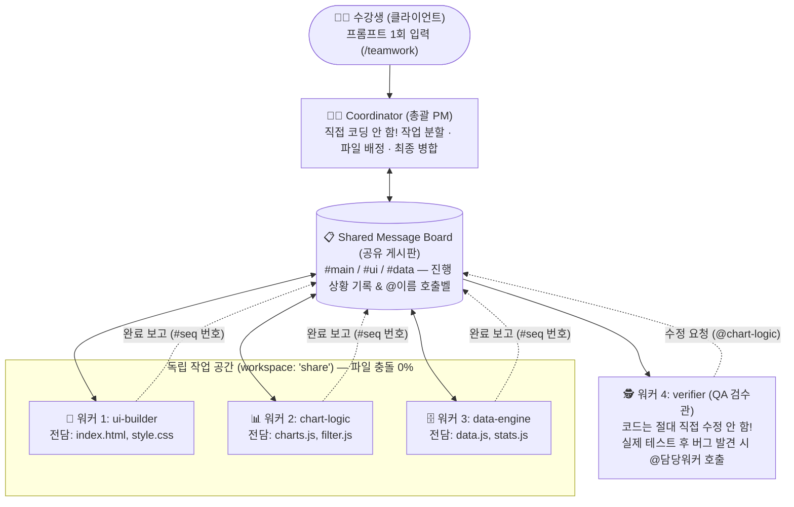
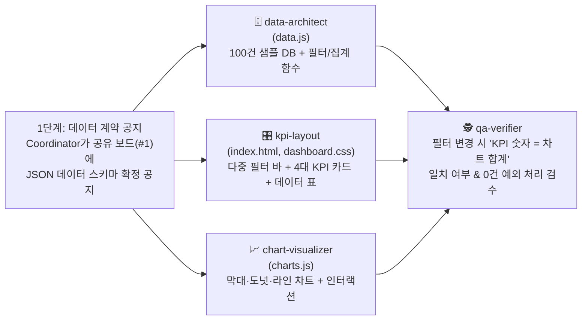

# [마스터 강의 교안] Google Antigravity (AGY) 2026-2.32.1 심화 활용 및 차세대 에이전트 실전 가이드

* **과정명**: Google Antigravity 2.0 & 2026-2.32.1 심화 마스터클래스 — 컨텍스트 타겟팅부터 멀티 에이전트 Swarm까지
* **문서 버전**: `GAY_2026-2.32.1` (2026년 11월 최신 릴리즈 반영 · Swarm 웹/대시보드 심층 보강판)
* **교육 목표**: 
  1. `@ to mention`, `@ to action`, `/ for actions` 3대 조작 체계를 완벽히 이해하고 자유자재로 조합한다.
  2. 2026년 최신 업데이트 기능인 **Native Swarm(군집 협업)**, **Dynamic Workflow(코드형 파이프라인)**, **Scheduled Automation(무인 스케줄링)**, **Generative UI(인라인 웹 위젯)**를 실무에 즉시 적용한다.
  3. **반응형 웹페이지 개발**과 **인터랙티브 대시보드 시각화 앱 개발**에 특화된 Swarm 역할 분담 아키텍처를 이해하고, **복사·붙여넣기(Copy & Paste)**만으로 실무용 웹앱을 즉시 완성한다.

---

## 📑 목차 (Table of Contents)

1. **[Module 1] 프롬프트 3대 제어 체계: `@ to mention`, `@ to action`, `/ for actions`**
2. **[Module 2] 2026 최신 슬래시 커맨드 & 무인 백그라운드 자동화 (`/automation`)**
3. **[Module 3] 차세대 멀티 에이전트 오케스트레이션: `Swarm` 쉬운 이해 & `Dynamic Workflows`**
4. **[Module 4] 채팅창을 넘어선 시각화 & 엔터프라이즈 커스터마이징 (`Generative UI`, `Hooks`, `Plugins`)**
5. **[Module 5] 멀티 서피스(IDE / App 2.0 / CLI) 핵심 단축키 및 Python SDK**
6. **[Module 6] 🎓 수강생 실습용: 그대로 복사해서 쓰는 기본·심화 프롬프트 레시피 12선**
7. **[Module 7] 🌐 Swarm 심층 프로젝트 Lab: 반응형 웹페이지 & 대시보드 시각화 앱 개발 (실전 복붙 팩)**
8. **[부록] 수강생 자주 묻는 질문 (FAQ) & 강의 전 체크리스트**

---

# [Module 1] 프롬프트 3대 제어 체계의 구조적 이해

Google Antigravity(AGY)의 프롬프트 입력창에 표기되는 안내 문구(`Ask anything, @ to mention, / for actions`)는 에이전트에게 전달할 **컨텍스트(맥락)를 정밀 타겟팅**하고, **특정 전문 에이전트/도구를 바인딩**하며, **자율 실행 워크플로우 모드**를 즉각 발동시키는 핵심 조작 체계입니다.

## 1.1 한눈에 보는 조작 아키텍처

```text
┌─────────────────────────────────────────────────────────────────────────┐
│                            Chat Input Box                               │
│         "Ask anything, @ to mention, / for actions..."                  │
└──────────────┬──────────────────────────────────────────┬───────────────┘
               │                                          │
         [@ 키 입력]                                 [/ 키 입력]
         ┌─────┴──────────────────────┐                   │
         ▼                            ▼                   ▼
  [@ to mention]               [@ to action]       [/ for actions]
  (어떤 정보를 볼 것인가)        (누가/무엇으로 행할 것인가) (어떤 방식으로 실행할 것인가)
  · 파일 / 폴더 (@src/...)      · 전문 서브에이전트 호출   · /plan (단계별 기획)
  · 코드 심볼 (@UserService)    · @research / @browser    · /goal (끝까지 자율 실행)
  · 터미널 로그 (@terminal)     · @image-generator        · /grill-me (인터뷰형 설계)
  · Git 변경분 (@git:diff)      · @firestore-rules-author · /teamwork (다중 에이전트)
  · 프로젝트 규칙 (@rule:...)   · @ai-architect 등        · /automation (정기 스케줄)
  · 이전 대화 (@conversation)   · @mcp:<서버명> 직접 지정  · /boost (고난도 심층 추론)
```

* **`@ to mention` (Context Targeting — 시야 고정)**
  전체 코드베이스를 무작정 탐색하느라 토큰과 시간을 낭비하지 않도록, 에이전트의 시야를 특정 파일, 함수/클래스 심볼, 에러 로그, 규칙에 **핀셋처럼 고정**합니다.
* **`@ to action` (Delegation & Tool Binding — 역할/도구 위임)**
  일반적인 LLM 질의응답을 넘어, 특정 역할에 특화된 **서브에이전트(Subagent)**나 외부 **MCP(Model Context Protocol)** 서버 도구에게 실행 권한을 직접 위임합니다.
* **`/ for actions` (Workflow Triggers — 실행 모드 전환)**
  자율 에이전트의 행동 방식(사전 계획 수립형, 역질문 인터뷰형, 다중 에이전트 협업형, 무중단 목표 완수형 등)을 전환하는 상위 제어 스위치입니다.

---

## 1.2 `@ to mention` : 정밀 컨텍스트 주입 레퍼런스

프롬프트 입력창에서 `@`를 타이핑하면 퍼지 검색(Fuzzy Search) 기반 자동완성 드롭다운이 열립니다.

| 멘션 카테고리 | 입력 예시 | 핵심 기능 및 강의실 활용 팁 |
| :--- | :--- | :--- |
| **Files (파일)** | `@src/auth/token.py`<br>`@package.json` | 지정한 파일의 전체 코드를 컨텍스트에 즉시 로드합니다. 파일명 일부만 입력해도 자동완성됩니다. |
| **Folders (디렉토리)** | `@src/components/`<br>`@tests/` | 해당 폴더의 파일 트리 구조 및 모듈 인터페이스 요약을 주입하여 전체 구조를 파악하게 합니다. |
| **Code Symbols (심볼)** | `@validate_token`<br>`@UserService` | 프로젝트 내에 인덱싱된 함수, 클래스, 인터페이스, 메서드를 직접 타겟팅합니다. **어느 파일에 있는지 몰라도 함수/클래스 이름만으로 호출**할 수 있어 가장 강력합니다. |
| **Terminal (터미널)** | `@terminal`<br>`@terminal:last-output` | 방금 실행한 터미널의 `stdout`/`stderr` 및 에러 스택 트레이스를 전달합니다. 에러 텍스트를 드래그해 복사할 필요 없이 `@terminal` 한 단어로 끝납니다. |
| **Git Context (깃)** | `@git:diff`<br>`@git:staged` | 현재 작업 트리의 수정 내역(Uncommitted diff)이나 스테이징된 변경분을 로드하여 **코드 리뷰, 커밋 메시지 생성, PR 본문 작성**에 활용합니다. |
| **Rules (규칙/지침)** | `@rule:clean-architecture`<br>`@rule:security` | `.agents/rules/` 또는 `GEMINI.md` / `AGENTS.md`에 정의된 팀 규칙을 이번 턴에 최우선으로 강제 준수하도록 주입합니다. |
| **Past Conversations** | `@conversation:<id>` | 이전 대화 세션의 맥락, 의사결정 사항, 디버깅 기록을 현재 세션으로 불러와 이어서 작업합니다. |
| **Web & Docs (웹/문서)** | `@web:https://...` | 공식 API 문서나 최신 릴리즈 노트 URL을 지정하여 환각(Hallucination) 없이 최신 스펙 기준으로 코딩하게 합니다. |

---

## 1.3 `@ to action` : 전문 서브에이전트 및 MCP 도구 위임

`@`를 통해 작업을 수행할 **전문가 에이전트(Subagent)** 또는 **외부 연결 도구(MCP)**를 직접 호명할 수 있습니다.

### (1) 내장 전문 서브에이전트 (Built-in Subagents) — 2026 최신 라인업
| 호출 명령어 | 전문 역할 | 언제 호출하나요? |
| :--- | :--- | :--- |
| **`@research`** (또는 `@researcher`) | **읽기 전용 코드/문서 조사관** | 파일 수정 없이 대규모 코드베이스의 의존성 추적, 아키텍처 파악, 기술 레퍼런스 조사를 **메인 대화창의 컨텍스트 오염 없이** 격리 수행할 때 사용합니다. |
| **`@browser`** | **웹뷰 브라우저 제어 에이전트** | 내장 브라우저를 직접 띄워 `localhost` 개발 서버 확인, 버튼 클릭, 폼 입력, UI 깨짐 검증, 콘솔 에러 캡처 등 E2E 동작을 눈으로 확인하고 조작할 때 사용합니다. |
| **`@image-generator`** | **시각 에셋 & 목업 생성기** | 웹/앱에 들어갈 아이콘, 배너 이미지, UI 디자인 목업, 다이어그램 에셋을 즉석에서 생성하고 파일로 저장할 때 호출합니다. |
| **`@firestore-rules-author`** | **Firestore 보안 규칙 전문가** | Firebase Cloud Firestore의 `firestore.rules` 파일을 작성하거나 보안 취약점을 감사(Audit)할 때 **필수 호출**하는 전담 에이전트입니다. |
| **`@ai-architect`** | **AI 애플리케이션 설계사** | AI SDK 패턴 설계, LLM 프로바이더 라우팅, 에이전트 툴 콜링, MCP 서버 연동 아키텍처를 설계할 때 호출합니다. |
| **`@deployment-expert`** | **배포 & CI/CD 파이프라인 전문가** | 프리뷰 배포, 프로덕션 승격, 롤백, 환경변수(Env) 구성, 도메인/DNS 연결 문제를 해결할 때 사용합니다. |
| **`@performance-optimizer`** | **웹 성능 & 번들 최적화 전문가** | Core Web Vitals(LCP/CLS/INP), 렌더링 전략(SSR/ISR/PPR), 캐싱, 이미지/폰트 및 번들 사이즈 최적화를 수행합니다. |
| **`@custom-agent:<name>`** | **사용자 정의 커스텀 에이전트** | `.agents/agents/<name>.md`에 직접 정의한 우리 팀만의 에이전트(예: `@db-migrator`, `@qa-tester`)를 호출합니다. |

### (2) MCP (Model Context Protocol) 서버 및 도구 명시적 바인딩
* **`@mcp:<server_name>`** (예: `@mcp:notion`, `@mcp:figma`, `@mcp:canva`, `@mcp:netlify`)
  - 연결된 외부 서비스의 MCP 도구를 명시적으로 지정하여, 로컬 파일 대신 외부 워크스페이스(Notion 페이지 생성, Figma 디자인 컨텍스트 추출, Canva 디자인 편집 등)에 직접 액션을 수행하도록 지시합니다.

---

# [Module 2] 워크플로우 슬래시 커맨드(`/`) & 백그라운드 자동화

프롬프트 입력창에 `/`를 입력하면 에이전트의 **사고방식과 실행 루프** 자체가 바뀝니다.

## 2.1 필수 슬래시 커맨드 11선 완벽 정리

| 슬래시 명령어 | 실행 모드 | 핵심 동작 원리 | 실전 추천 상황 |
| :--- | :--- | :--- | :--- |
| **`/plan`** | **단계별 사전 기획** | 코드를 바로 고치지 않고, 먼저 아티팩트(Markdown 계획서)를 작성해 사용자의 `[Proceed]` 승인을 기다립니다. | 대규모 리팩토링, DB 스키마 변경, 신규 기능 아키텍처 설계 전 필수 |
| **`/grill-me`** | **역질문 인터뷰 설계** | 에이전트가 먼저 날카로운 객관식/주관식 질문을 던져 모호한 요구사항과 엣지 케이스를 확정합니다. | 아이디어만 있고 세부 기획(예외 처리, 권한, UI 흐름)이 덜 정해졌을 때 |
| **`/goal`** | **무중단 목표 완수** | 지정한 완료 조건(예: 모든 테스트 통과, 빌드 에러 0건)이 달성될 때까지 멈추지 않고 자율 루프를 돕니다. | 퇴근 전 야간 작업, 수십 개의 연쇄 컴파일 에러/테스트 실패 일괄 해결 |
| **`/teamwork`** | **다중 에이전트 협업** | 여러 에이전트가 역할(기획, 프론트, 백엔드, 검증)을 나누어 병렬로 동시에 작업합니다. | 프론트엔드와 백엔드, 테스트 코드를 한 번에 개발해야 하는 큰 프로젝트 |
| **`/browser`** | **브라우저 라이브 검증** | 로컬 서버나 실제 웹페이지를 브라우저로 열어 클릭·스크롤·폼 입력을 수행하며 UI를 검증합니다. | 화면을 만든 직후 실제 렌더링 상태와 반응형 레이아웃을 점검할 때 |
| **`/boost`** | **초심층 다각도 추론** | Deep Thinking, 다중 관점 비교, 엄격한 자기 검증을 활성화하여 최고 난이도 문제를 해결합니다. | 원인을 알 수 없는 레이스 컨디션(동시성 버그), 복잡한 알고리즘 최적화 |
| **`/learn`** | **지식/규칙 영구 학습** | 방금 해결한 시행착오나 사용자가 교정한 코딩 스타일을 `.agents/rules/` 또는 스킬로 영구 저장합니다. | "앞으로도 이 프로젝트에서는 무조건 이 방식으로 짜줘"라고 학습시킬 때 |
| **`/compact`** | **컨텍스트 압축 정리** | 긴 대화에서 불필요한 로그를 덜어내고 핵심 결정사항과 상태만 압축하여 토큰 여유 공간을 확보합니다. | 대화가 길어져 응답이 느려지거나 이전 맥락을 헷갈리기 시작할 때 |
| **`/schedule`** | **단발성/주기 타이머** | 현재 작업 세션 내에서 N초/분 뒤 알림이나 주기적 폴링/체크 타이머를 예약합니다. | 배포 완료 대기, 비동기 배치 작업 모니터링 |
| **`/automation`** | **크론(Cron) 백그라운드 자동화** | **(2026 신규)** 매일/매주 정해진 시간에 새 에이전트 세션을 깨워 업무를 자동 수행하는 상주 사이드카를 생성합니다. | 매일 아침 9시 PR 리뷰 요약, 일일 에러 리포트, 주간 노션 보고서 자동화 |
| **`/btw`** | **컨텍스트 분리 질문** | 현재 진행 중인 메인 작업 흐름을 방해하지 않고 가벼운 문법/개념 질문을 던집니다. | 코딩 시키던 도중 잠깐 정규식 문법이나 리눅스 명령어가 궁금할 때 |

---

## 2.2 [2026 핵심 업데이트] `/automation` 무인 백그라운드 자동화

과거에는 사람이 직접 채팅창에 프롬프트를 입력해야만 에이전트가 움직였지만, 이제 **`/automation`** 명령어를 통해 **지정된 시간(Cron)마다 스스로 깨어나 일하는 무인 에이전트**를 1분 만에 만들 수 있습니다.

### 작동 프로세스 (5-Step 대화형 생성 마법사)
1. **Turn 1 (주기 선택)**: `/automation`을 입력하면 에이전트가 객관식 질문(`Hourly`, `Daily`, `Weekly`, `Custom cron`)을 띄웁니다.
2. **Turn 2 (시간/요일 지정)**: 예를 들어 `Daily` ➔ `오전 9:00`를 선택하면 내 PC의 타임존(`CRON_TZ=Asia/Seoul 0 9 * * *`)을 자동 감지합니다.
3. **Turn 3 (수행할 업무 지시)**: 에이전트가 매번 깨어날 때 실행할 작업(예: *"열려 있는 GitHub PR 중 테스트가 실패한 항목을 찾아 요약해줘"*)을 자연어로 입력합니다.
4. **Turn 4 (자동화 생성 & 사전 테스트)**: `~/.gemini/config/sidecars/<id>/sidecar.json` 설정 파일이 자동 생성되며, 무인 실행 시 권한 막힘(Permission Deny)이 없도록 **1회 테스트 실행(Test-Run)**을 제안합니다.
5. **Turn 5 (대시보드 활성화)**: 테스트에서 검증된 최소 권한(`command(...)`, `mcp(...)`)만 안전하게 등록된 후, 채팅창의 `[Open Automations Dashboard](sidecar://dashboard)` 버튼을 눌러 스위치를 켜면 완료됩니다.

---

# [Module 3] 차세대 멀티 에이전트 오케스트레이션: `Swarm` 쉬운 이해 & `Dynamic Workflows`

단일 에이전트가 순차적으로 일하는 시대를 넘어, Antigravity 2026-2.32.1에서는 **두 가지 강력한 멀티 에이전트 엔진**(`Native Swarm`과 `Dynamic Workflows`)을 제공합니다.

---

## 3.1 초보자도 3분 만에 이해하는 Native Swarm (`swarm` / `/teamwork`)

### 🍳 쉬운 비유: "1인 푸드트럭" vs "4인 전문 셰프 레스토랑 주방"
* **일반 에이전트 (1인 푸드트럭)**: 요리사 한 명이 주문받고, 재료 썰고, 고기 굽고, 설거지까지 혼자 다 합니다. 메뉴가 간단할 땐 빠르지만, **코스 요리(복잡한 웹페이지나 대시보드)**를 시키면 앞선 주문을 잊어버리거나(컨텍스트 초과), 소스를 만들다 스테이크를 태웁니다(기존 코드 파손).
* **Native Swarm (4인 전문 셰프 주방)**:
  - **총괄 셰프 (`coordinator`)**: 손님(사용자)의 주문을 받아 요리사들에게 역할을 나누어 주고 직접 프라이팬을 잡지 않습니다.
  - **전담 요리사들 (`ui-builder`, `chart-logic`, `data-engine`)**: 각자 자기 도마(독립 작업 공간)에서 **자기 파일만** 동시에 요리합니다.
  - **주문 전광판 (`Shared Message Board`)**: 요리사들이 *"나 소스 다 만들었어(`#4`), 이제 플레이팅해!"*라고 글을 올리는 공유 게시판입니다.
  - **맛 감별사 (`verifier`)**: 완성된 요리를 먹어보고 싱거우면 직접 소금을 치는 대신, **"@소스담당, 소금 2g만 더 넣어줘!"**라고 지시하여 맛을 완벽하게 잡습니다.



---

### 💡 Swarm을 성공시키는 4대 핵심 작동 원리 (강의 핵심 포인트)

#### 원리 1: "1 워커 = 전용 파일 전담"으로 파일 충돌을 0%로 만든다 (`File Ownership`)
두 명의 에이전트가 동시에 `app.js` 하나를 고치면 코드가 뒤엉킵니다. 따라서 Swarm을 부를 때는 **`data-engine`은 `data.js`만**, **`ui-builder`는 `index.html`과 `style.css`만** 건드리도록 파일 소유권을 명확히 나누어 주고, 각 워커에게 `workspace: "share"`(독립된 작업 복사본)를 부여합니다.

#### 원리 2: `@이름`은 단순 멘션이 아니라 "잠든 워커를 깨우는 호출벨(Doorbell)"이다
Swarm의 워커들은 평소에는 **`waiting` (대기/수면)** 상태로 보드에 누워 있으며, **잠들어 있는 동안에는 토큰이나 비용을 전혀 소모하지 않습니다.**  
누군가 보드에 `@chart-logic #2번 데이터 스키마 완성됐으니 차트 연결해!`라고 **`@이름`을 불러줄 때만 깨어나** 자기 턴을 실행합니다.

#### 원리 3: 이전 작업 내용을 복사해 전달하지 않고 `#게시글번호`로 소통한다
워커끼리 긴 코드를 다시 복사해서 전달하면 토큰이 낭비됩니다. 공유 보드에는 모든 메시지에 순서 번호(`#1`, `#2`, `#3`...)가 붙기 때문에, **`@verifier #4번과 #6번 결과물을 확인해서 통합 테스트해줘`**처럼 번호로만 지시해도 정확히 알아듣습니다.

#### 원리 4: 검수관(`verifier`)은 절대 직접 코드를 고치지 않는다
검수관(`verifier`)이 버그를 발견했다고 직접 파일을 열어 수정하면 원래 담당 워커의 작업과 충돌합니다. 검수관은 오직 **테스트 실행 및 화면 검증만 수행**하고, 발견한 문제점을 `@담당워커`에게 리포트하여 **원래 작성자가 직접 고치게 만드는 것**이 Swarm 품질의 핵심 비결입니다.

---

### 📊 Swarm 워커 상태(`status`) 4가지 읽는 법
Swarm 보드나 상태 창에서 각 워커는 다음 4가지 상태 중 하나로 표시됩니다:
* 🟢 **`working`**: 현재 열심히 생각하거나 코드를 작성/실행 중인 상태입니다.
* 💤 **`waiting`**: 보드에서 다음 지시(`@멘션`)를 기다리며 잠들어 있는 상태입니다. (비용 0)
* ⏸️ **`stopped`**: 서버 재시작 등으로 일시 정지된 상태입니다. 보드에서 `@이름`을 부르면 즉시 다시 깨어납니다.
* 🔴 **`killed`**: 임무를 마치고 영구 퇴근(종료)한 상태입니다. (독립 워크스페이스도 함께 정리됨)

> [!TIP]
> **작업 도중 특정 워커의 모델 쿼터(Quota)가 소진되면?**
> 워커를 죽이고(`kill`) 새로 만들 필요가 없습니다! `swarm{action: "model", name: "워커이름"}` 기능을 통해 **기존 대화 맥락과 작업 내용을 그대로 유지한 채 다른 모델로 바통 터치**하여 작업을 이어갈 수 있습니다.

---

## 3.2 Dynamic Workflows (`run_workflow`) : Python 기반 동적 오케스트레이션

> [!WARNING]
> **중요 변경사항**: 과거 `.agents/workflows/*.md`에 작성하던 정적 마크다운 워크플로우 방식은 **Deprecated(구형화)** 되어 모두 **Skills(`.agents/skills/<name>/SKILL.md`)**로 통합되었습니다. (기존 파일은 `migrate-workflows` 스킬로 1초 만에 자동 변환 가능)

반면, Antigravity의 **Dynamic Workflow(`run_workflow`)**는 **Python 스크립트로 수십 개의 에이전트를 반복문·병렬(Fan-out)·직렬 파이프라인으로 제어하는 프로그래밍 오케스트레이션**입니다.

### 핵심 프리미티브 5가지
| 함수명 | 동작 설명 | 활용 예시 |
| :--- | :--- | :--- |
| **`phase("단계명")`** | UI 상에서 워크플로우 진행 단계를 시각적으로 그룹핑합니다. | `phase("1단계: 취약점 스캔")`, `phase("2단계: 패치 검증")` |
| **`agent(prompt, schema, role)`** | JSON Schema로 출력 형식이 엄격히 고정된 에이전트 작업을 정의합니다. | 파일 목록을 JSON 배열(`{"type": "array"}`)로 정확히 반환받기 |
| **`parallel(items, fn)`** | 리스트의 모든 항목에 대해 여러 에이전트를 **동시에 병렬 실행**하고 결과를 모읍니다. | 30개 API 파일을 동시에 각각 보안 리뷰하기 |
| **`pipeline(items, fn)`** | 리스트의 항목들을 순서대로 하나씩 직렬 실행합니다. | DB 마이그레이션 1단계 ➔ 2단계 ➔ 3단계 순차 적용 |
| **`trajectory(...)`** | 현재 대화의 이전 실행 기록(실패한 명령어 로그 등)을 읽어와 분석에 활용합니다. | 최근 실패한 테스트 로그 20개만 추출하여 분석 에이전트에 전달 |

---

# [Module 4] 채팅창 인라인 시각화 & 엔터프라이즈 커스터마이징

## 4.1 Generative UI (`<agent-embed>`) & Sidecar Viewers

텍스트와 정적 표만으로는 복잡한 데이터나 로직을 설명하기 어렵습니다. Antigravity는 **채팅창 내부에 즉시 작동하는 인터랙티브 HTML/Tailwind 웹 위젯**을 렌더링하는 **Generative UI** 기능을 탑재하고 있습니다.

* **인라인 위젯 (Inline Widget, 높이 450px 이하)**: 슬라이더, 탭 버튼, 실시간 계산기, 미니 차트 등을 채팅 답변 중간에 `<agent-embed>`로 바로 띄워 학생이나 실무자가 마우스로 조작해 볼 수 있습니다.
* **독립형 대시보드 아티팩트 (Standalone Artifact)**: 넓고 복잡한 다중 탭 대시보드나 전체 화면 탐색기는 우측 아티팩트 패널에 풀사이즈 웹앱으로 생성합니다.
* **과학/전문 Sidecar Viewers**: 단백질 3D 구조(`Biomolecular Structure Viewer`), Android 디바이스 미러링(`Android Device Hub`), Jetpack Compose 프리뷰 등 전용 인터랙티브 사이드카 패널을 원클릭 알약 링크(`sidecar://...`)로 즉시 호출할 수 있습니다.

---

## 4.2 5대 커스터마이징 체계 (Rules, Skills, Plugins, Hooks, MCP)

우리 팀과 프로젝트의 규칙을 에이전트에게 이식하는 5가지 방법입니다.

| 구분 | 설정 파일 위치 | 작동 범위 | 핵심 용도 |
| :--- | :--- | :--- | :--- |
| **1. Rules (규칙)** | `GEMINI.md`, `AGENTS.md`, `.agents/rules/*.md` | 상시 또는 조건부 자동 적용 | 코딩 컨벤션, 금지 API, 보안 원칙, 아키텍처 가이드라인 강제 |
| **2. Skills (스킬)** | `.agents/skills/<name>/SKILL.md` | 온디맨드 (Progressive Disclosure) | 다단계 업무 매뉴얼, 배포 절차서, 전용 스크립트 및 `/스킬명` 커맨드화 |
| **3. Plugins (플러그인)** | `.agents/plugins/<name>/plugin.json` | 패키지 번들 단위 | 관련 Skills + Rules + Hooks + MCP 설정을 하나로 묶어 팀원에게 배포 |
| **4. Hooks (훅)** | `.agents/hooks.json` | 에이전트 생명주기 이벤트 | 도구 실행 전/후(`PreToolUse`, `PostToolUse`), 종료 시(`Stop`) 자동 검증 스크립트 실행 |
| **5. MCP Servers** | `mcp_config.json` | 외부 도구/DB 연결 | Notion, Figma, Canva, GitHub, 사내 DB 등 외부 시스템을 에이전트 손발로 연결 |

> [!NOTE]
> **왜 스킬을 많이 만들어도 토큰이 낭비되지 않나요? (Progressive Disclosure 원리)**
> Antigravity는 평소에는 스킬의 **`name`과 `description`(한 줄 요약)**만 메모리에 들고 있습니다. 그러다 사용자의 질문이 특정 스킬과 관련된 순간에만 해당 `SKILL.md` 본문을 펼쳐 읽으므로, 수백 개의 스킬을 등록해도 컨텍스트 창이 항상 가볍게 유지됩니다!

### 로딩 우선순위 (충돌 시 높은 번호가 우선 적용)
1. **Workspace Project** (`.agents/` — 현재 프로젝트 루트) *(최우선)*
2. **Declared Configs** (`skills.json`, `plugins.json`에 명시된 설정)
3. **Global Config** (`~/.gemini/config/` — 내 PC 전체 공통)
4. **Built-in Customizations** (Antigravity 기본 내장 스킬)

---

## 4.3 `hooks.json` 라이프사이클 훅 (안전망 & 자동화 가드레일)

에이전트가 실수로 위험한 명령을 실행하거나, 테스트를 통과하지 않은 채 작업을 끝내는 것을 **코드 레벨에서 100% 통제**하는 기능입니다.

* **6대 이벤트 시점**:
  1. `SessionStart`: 새 대화가 시작될 때 프로젝트 환영 메시지나 초기 컨텍스트 자동 주입
  2. `PreToolUse`: 에이전트가 명령어(`run_command`)나 파일 수정을 실행하기 **직전**에 가로채어 허용(`allow`), 차단(`deny`), 사용자 확인(`ask`), 또는 명령어 강제 재작성(`overwrite`) 수행
  3. `PostToolUse`: 파일 수정이나 명령 실행 **직후**에 자동으로 Linter나 Formatter(`prettier`, `eslint`) 실행
  4. `PreInvocation` / `PostInvocation`: 모델 호출 전후에 시스템 지침 주입 또는 강제 루프 지속
  5. `Stop`: 에이전트가 "다 끝났습니다" 하고 멈추려 할 때, 백그라운드 테스트가 실패했으면 멈추지 못하게 막고(`"decision": "continue"`) 재수정을 강제함

---

## 4.4 타 코딩 에이전트 설정 1분 마이그레이션 (`migrate-agent-settings`)

기존에 **Claude Code, Cursor, OpenAI Codex, Gemini CLI**를 쓰던 학생이나 개발자라면 설정을 처음부터 다시 짤 필요가 없습니다!
* Antigravity에 내장된 **`migrate-agent-settings`** 스킬을 호출하면, 내 PC에 있는 `~/.claude/`, `.cursor/rules/*.mdc`, `~/.codex/`, `~/.gemini/`의 MCP 서버, 커스텀 프롬프트, 규칙 파일들을 자동으로 스캔하여 `~/.gemini/config/plugins/migrated-settings/`라는 **단일 Antigravity 플러그인으로 깔끔하게 일괄 변환**해 줍니다.

---

# [Module 5] 멀티 서피스(IDE / App 2.0 / CLI) & Python SDK 요약

Antigravity는 작업 스타일에 따라 4가지 환경(Surface)을 완벽히 호환 제공합니다.

1. **Antigravity IDE (코드 에디터 중심)**
   - **Tab (Supercomplete & Tab-to-Jump)**: 단순 한 줄 자동완성을 넘어, 여러 줄의 Diff(삭제 포함)를 제안하고 다음 수정할 코드 위치로 커서를 점프시킵니다. 미선언 패키지 사용 시 상단 `import` 문을 자동 추가(Tab to Import)합니다.
   - **`Ctrl + I` (macOS: `⌘ + I`)**: 드래그한 코드 블록만 핀셋처럼 리팩토링하거나 주석/독스트링을 생성하는 인라인 커맨드입니다.
   - **Inline Code Lenses & Diagnostic Auto-Fix**: 함수 위 버튼이나 빨간 줄(컴파일/린트 에러)에서 원클릭으로 에이전트 자동 수정을 호출합니다.
2. **Antigravity 2.0 Desktop App (에이전트 오케스트레이션 지휘소)**
   - 여러 프로젝트 워크스페이스를 오가며 다중 에이전트(Swarm), 예약 작업(Scheduled Tasks), 스킬/플러그인, 그리고 **샌드박스 보안 정책(Terminal Sandbox, 인터넷/파일 접근 권한, 브라우저 허용 도메인)**을 중앙 제어합니다.
3. **Antigravity CLI (`agy`)**
   - 터미널에서 `agy`를 입력해 즉시 실행하는 초경량 TUI 에이전트입니다. (`~/.gemini/antigravity-cli/settings.json`으로 설정 관리, `/help`로 명령어 확인, `Ctrl+D` 두 번으로 종료)
4. **Antigravity Python SDK (`google-antigravity`)**
   - `pip install google-antigravity` 설치 후 Python 코드 안에서 비동기(`async with Agent(config) as agent:`)로 에이전트를 생성하고, 에이전트의 생각(`response.thoughts`)과 도구 호출(`response.tool_calls`)을 실시간 스트리밍으로 제어할 수 있습니다.

---

# [Module 6] 🎓 수강생 실습용: 그대로 복사해서 쓰는 기본·심화 프롬프트 레시피 12선

> [!IMPORTANT]
> **수강생 실습 안내 (Zero-Friction Copy & Paste)**
> 어려운 명령어 문법을 외울 필요가 없습니다! 상황에 맞는 레시피를 골라 **코드 블록 우측 상단의 [복사(Copy)] 버튼을 누른 뒤 채팅창에 붙여넣고, `[대괄호]` 안의 내용만 내 상황에 맞게 바꿔서 엔터**를 치세요.

---

### 🧪 레시피 01. [입문] 터미널 에러 로그 1초 주입 및 단계별 해결 기획 (`@terminal` + `/plan`)
* **상황**: 터미널에 빨간색 에러가 잔뜩 떴는데, 어디서부터 고쳐야 할지 모를 때 (에러 메시지를 마우스로 드래그해 복사할 필요가 없습니다!)
* **난이도**: ★☆☆

**[👇 아래 프롬프트를 복사하여 붙여넣으세요]**
```text
@terminal /plan
방금 터미널에서 발생한 에러의 근본 원인을 분석해줘.
코드를 바로 수정하지 말고, 어떤 파일의 어느 부분을 어떻게 고쳐야 하는지 단계별 해결 계획(Artifact)을 먼저 세워서 나에게 보여줘.
```
* **💡 포인트**: 특정 파일이 의심된다면 맨 앞에 `@src/문제파일.ts`를 함께 적어주면 분석 속도가 3배 빨라집니다.

---

### 🧪 레시피 02. [입문] 파일 위치를 몰라도 함수/클래스 이름만으로 핀셋 리팩토링 (`@심볼` + `@rule`)
* **상황**: 프로젝트가 커서 해당 클래스가 어느 폴더에 있는지 찾기 귀찮을 때, 심볼 이름만으로 타겟팅하여 깔끔하게 구조를 개선합니다.
* **난이도**: ★☆☆

**[👇 아래 프롬프트를 복사하여 붙여넣으세요]**
```text
@[함수또는클래스명] /plan
이 심볼의 현재 구현 코드를 찾아 분석하고, 가독성과 유지보수성을 높이기 위해 단일 책임 원칙(SRP)에 맞게 리팩토링하는 계획을 세워줘. 기존 외부 호출 인터페이스(함수 시그니처)는 깨지지 않도록 유지해줘.
```
* **💡 수정할 곳**: `@[함수또는클래스명]`을 실제 코드 내 이름(예: `@UserService`, `@calculateTotal`)으로 바꾸세요. (`@`를 치고 두세 글자만 입력하면 자동완성 목록이 뜹니다!)

---

### 🧪 레시피 03. [초급] 커밋 전 내 코드 변경분(Diff) 셀프 감사 및 PR 본문 생성 (`@git:diff`)
* **상황**: 작업한 코드를 Git에 올리기 전에 혹시 실수한 부분이나 보안 구멍이 없는지 점검하고, 깔끔한 커밋 메시지와 PR 설명을 한 번에 뽑아낼 때 사용합니다.
* **난이도**: ★☆☆

**[👇 아래 프롬프트를 복사하여 붙여넣으세요]**
```text
@git:diff
현재 작업 트리의 모든 변경 사항을 꼼꼼히 리뷰해줘.
1. 잠재적인 버그, 예외 처리 누락, 보안 취약점이나 하드코딩된 민감 정보가 있는지 지적해줘.
2. 문제가 없다면 Conventional Commits 규격에 맞는 깔끔한 커밋 메시지(한글/영문 병기)와 팀원들을 위한 Pull Request 요약 본문을 마크다운으로 작성해줘.
```

---

### 🧪 레시피 04. [초급] 막연한 아이디어를 완벽한 기획서로! AI 역질문 인터뷰 (`/grill-me`)
* **상황**: 만들고 싶은 기능은 있는데, 세부 기획이나 예외 케이스를 어떻게 정의해야 할지 막막할 때 **AI가 먼저 나에게 질문하게** 만듭니다.
* **난이도**: ★★☆

**[👇 아래 프롬프트를 복사하여 붙여넣으세요]**
```text
/grill-me
내가 이번에 만들고 싶은 기능은 [구현하고 싶은 기능이나 서비스 한 줄 설명]이야.
아직 세부 요구사항이 완벽하지 않으니, 코드를 작성하기 전에 시니어 프로덕트 매니저이자 아키텍트 관점에서 내가 결정해야 할 핵심 질문(데이터 구조, 사용자 흐름, 예외 케이스, 디자인 스타일 등)을 객관식 위주로 인터뷰해줘.
인터뷰가 끝나면 내 답변을 종합해서 최종 구현 기획서를 만들어줘.
```
* **💡 수정할 곳**: `[구현하고 싶은 기능이나 서비스 한 줄 설명]`에 예: `수강생 교육 만족도 실시간 통계 대시보드` 또는 `사내 회의실 예약 시스템` 등을 입력하세요.

---

### 🧪 레시피 05. [중급] 메인 대화창 오염 없이 대규모 코드베이스/레퍼런스 조사 (`@research`)
* **상황**: 코드 수정 전에 프로젝트 전체에서 특정 데이터나 API가 어떻게 흘러가는지 파악하고 싶을 때, 읽기 전용 조사 에이전트에게 요약을 시킵니다.
* **난이도**: ★★☆

**[👇 아래 프롬프트를 복사하여 붙여넣으세요]**
```text
@research
현재 워크스페이스 전체를 조사해서 [조사할 주제, 예: 사용자 인증 토큰이 생성되고 API 요청마다 검증되는 전체 흐름]을 추적해줘.
관련된 핵심 파일 경로와 라인 번호를 링크로 걸어주고, 데이터 흐름을 Mermaid 시퀀스 다이어그램으로 요약해서 보고해줘. (파일 수정은 하지 마)
```
* **💡 효과**: 조사 과정에서 수십 개의 파일을 읽더라도 서브에이전트(`@research`)의 독립된 공간에서 처리되므로, 내 메인 채팅창의 토큰이 낭비되지 않습니다.

---

### 🧪 레시피 06. [중급] 테스트가 100% 통과할 때까지 알아서 고치는 자율 루프 (`/goal`)
* **상황**: 에러가 연쇄적으로 발생하거나 E2E/단위 테스트가 계속 깨질 때, 에이전트가 **"코드 수정 ➔ 테스트 실행 ➔ 실패 원인 분석 ➔ 재수정"**을 성공할 때까지 스스로 반복하게 합니다.
* **난이도**: ★★☆

**[👇 아래 프롬프트를 복사하여 붙여넣으세요]**
```text
@[테스트파일경로] /goal
이 테스트 파일(및 관련된 전체 테스트 스위트)을 실행해서 모든 테스트 케이스가 100% 통과(Pass)하고 빌드 에러가 0건이 될 때까지 중단하지 말고 원인을 찾아 코드를 수정하고 재검증해줘.
주의: 테스트를 억지로 통과시키기 위해 테스트 검증 조건을 삭제하거나 우회하지 말고, 실제 비즈니스 로직 버그를 해결해줘.
```
* **💡 수정할 곳**: `@[테스트파일경로]`에 예: `@tests/checkout.spec.ts`를 지정하거나, 전체 테스트라면 멘션 없이 `/goal`만 입력해도 됩니다.

---

### 🧪 레시피 07. [중급] 내장 브라우저 에이전트로 실제 화면 클릭 및 UI/콘솔 검증 (`@browser` / `/browser`)
* **상황**: 프론트엔드 코드를 짰는데 실제로 브라우저에서 잘 뜨는지, 버튼을 눌렀을 때 콘솔 에러는 없는지 에이전트가 직접 브라우저를 열어 확인하게 합니다.
* **난이도**: ★★☆

**[👇 아래 프롬프트를 복사하여 붙여넣으세요]**
```text
@browser
현재 로컬 개발 서버([http://localhost:3000 등 확인할 주소])를 브라우저로 열어서 다음 시나리오를 직접 테스트하고 검증해줘:
1. 메인 화면이 깨짐 없이 렌더링되는지 확인하고 스크린샷을 찍어줘.
2. [테스트할 동작, 예: 상단 필터 드롭다운을 클릭해 '동탄중앙이음터'를 선택하고 차트 숫자가 바뀌는지 확인]을 수행해줘.
3. 브라우저 개발자 도구 콘솔에 에러(Error)나 경고(Warning)가 발생하는지 확인해서 결과를 보고해줘.
```
* **💡 팁**: 아직 로컬 서버를 켜지 않았다면 *"먼저 로컬 개발 서버를 백그라운드로 실행한 뒤, @browser로 접속해서 확인해줘"*라고 지시하면 서버 구동부터 브라우저 검증까지 한 번에 수행합니다.

---

### 🧪 레시피 08. [고급] 채팅창 안에 바로 조작 가능한 인터랙티브 웹 위젯 띄우기 (`Generative UI`)
* **상황**: 단순 텍스트 설명이나 표 대신, 마우스로 슬라이더를 움직이고 탭을 클릭하며 시뮬레이션할 수 있는 **살아있는 미니 웹앱**을 채팅창 안에 즉시 렌더링합니다.
* **난이도**: ★★☆

**[👇 아래 프롬프트를 복사하여 붙여넣으세요]**
```text
Generative UI 스킬을 활용해서 채팅창 안에서 바로 조작할 수 있는 인라인 인터랙티브 위젯(<agent-embed>)을 만들어줘.
- 위젯 주제: [만들고 싶은 시뮬레이터/계산기/차트 주제, 예: 교육 프로그램 예산 배분 및 수강생 만족도 예측 시뮬레이터]
- 인터랙티브 컨트롤: 슬라이더 3개, 카테고리 선택 탭 버튼, 실시간 리셋 버튼
- 출력 화면: 컨트롤 조작에 따라 실시간으로 수치가 변하는 KPI 요약 카드와 비교 막대그래프
- 디자인: 다크/라이트 테마에 모두 호환되는 시맨틱 컬러 변수와 깔끔한 레이아웃 적용 (높이 450px 이하 인라인 최적화)
```

---

### 🧪 레시피 09. [고급] 다중 에이전트 팀(Swarm) 기본 호출 템플릿 (`/teamwork`)
* **상황**: 규모가 큰 기능을 만들 때 백엔드 담당, 프론트엔드 담당, 그리고 코드 검증(QA) 담당 에이전트를 동시에 띄워 공유 보드에서 협업하게 합니다.
* **난이도**: ★★★

**[👇 아래 프롬프트를 복사하여 붙여넣으세요]**
```text
/teamwork
다음 프로젝트를 완성하기 위해 Native Swarm(다중 에이전트 협업팀)을 구성해서 병렬로 진행해줘:
- 최종 목표: [구현할 프로젝트/기능 설명, 예: CSV 업로드 기능을 갖춘 실시간 매출 분석 웹 대시보드 구축]
- 워커(Worker) 구성 및 역할 분담:
  1. `data-engine` (workspace: "share"): 데이터 파싱, 통계 계산 유틸리티 및 샘플 데이터셋 모듈 작성
  2. `ui-builder` (workspace: "share"): 대시보드 레이아웃, 필터 컴포넌트, 차트 시각화 UI 작성
  3. `verifier` (workspace: "inherit"): 위 두 워커의 작업이 완료되면 통합 동작 및 엣지 케이스(빈 데이터, 잘못된 파일 등)를 엄격히 검증하고 문제가 있으면 해당 워커에게 수정 요청
모든 검증이 통과되면 변경 사항을 내 워크스페이스에 통합하고 최종 결과와 Swarm 보드 상태를 알려줘.
```

---

### 🧪 레시피 10. [고급] Python 동적 워크플로우로 수십 개 파일 일괄 감사 및 작업 (`run_workflow`)
* **상황**: 폴더 안에 있는 10개~50개의 파일을 하나씩 빠짐없이 검사하거나 일괄 변환해야 할 때, `run_workflow`의 `parallel()` 병렬 팬아웃(Fan-out) 기능을 사용합니다.
* **난이도**: ★★★

**[👇 아래 프롬프트를 복사하여 붙여넣으세요]**
```text
run-workflow 스킬을 참조해서 `run_workflow` 도구로 다음 다단계 동적 파이프라인을 실행해줘:
1. Phase 1 ("대상 파일 탐색"): `@[대상폴더경로]` 하위의 모든 소스 파일 목록을 JSON 배열로 추출하는 에이전트 실행
2. Phase 2 ("병렬 코드 감사"): 추출된 각 파일에 대해 `parallel()`을 사용하여 동시에 에이전트를 띄우고, [검사 기준, 예: 보안 취약점, 미사용 변수, 에러 처리 누락 여부]를 3줄 이내로 진단
3. Phase 3 ("종합 리포트"): 진단 결과 중 수정이 필요한 파일과 핵심 개선 사항만 모아서 마크다운 표로 최종 요약 출력
```
* **💡 수정할 곳**: `@[대상폴더경로]`에 예: `@src/`를 넣고, `[검사 기준...]`에 원하는 점검 항목을 적으세요.

---

### 🧪 레시피 11. [고급] 매일/매주 정해진 시간에 혼자 일하는 무인 자동화 비서 만들기 (`/automation`)
* **상황**: 매일 아침 출근 전이나 매주 월요일마다 반복되는 확인 업무(깃허브 PR 체크, 일일 로그 요약, 노션 주간 보고서 초안 생성 등)를 크론(Cron) 자동화로 등록합니다.
* **난이도**: ★★☆

**[👇 아래 프롬프트를 복사하여 붙여넣으세요]**
```text
/automation
매주 [요일 및 시간, 예: 월요일 오전 9시]마다 자동으로 실행되는 백그라운드 자동화 작업을 만들어줘.
- 자동화 이름: [자동화 표시 이름, 예: Weekly Project Digest]
- 수행할 작업 프롬프트: "현재 프로젝트의 최근 7일간 Git 커밋 내역과 변경된 문서들을 확인해서, 주간 주요 성과, 변경된 파일 요약, 이번 주 점검해야 할 핵심 체크리스트를 마크다운 보고서로 정리해줘."
설정을 생성한 뒤, 권한(Permission) 문제가 없도록 지금 바로 1회 테스트 실행(Test-Run)까지 안내해줘.
```

---

### 🧪 레시피 12. [마스터] 방금 해결한 노하우를 영구 스킬/규칙으로 저장 + 타 툴 설정 이관 (`/learn` & `migrate`)
* **상황 A (`/learn`)**: 어렵게 버그를 잡았거나 내가 원하는 디자인/코딩 스타일을 에이전트에게 가르쳤을 때, 다음 대화에서도 까먹지 않도록 프로젝트 영구 규칙이나 스킬로 박제합니다.
* **상황 B (`migrate-agent-settings`)**: 기존에 쓰던 Cursor나 Claude Code의 설정을 Antigravity로 한 번에 가져옵니다.

**[👇 상황 A: 방금 작업한 방식을 영구 규칙/스킬로 저장할 때 복사하세요]**
```text
/learn
방금 우리가 문제를 해결한 방식과 내가 요청했던 [스타일/규칙 핵심 키워드, 예: 공공기관 다크 네이비 대시보드 디자인 규격 및 개인정보 마스킹 원칙]을 앞으로의 모든 작업에서도 동일하게 재사용할 수 있도록 `.agents/` 하위에 프로젝트 전용 Rule(또는 재사용 가능한 Skill)로 깔끔하게 문서화해서 저장해줘.
```

**[👇 상황 B: Cursor / Claude Code / Codex 설정을 한 번에 가져올 때 복사하세요]**
```text
migrate-agent-settings 스킬을 사용해서 내 PC에 설치된 다른 코딩 에이전트(Claude Code, Cursor, Codex, Gemini CLI)의 MCP 서버, 커스텀 명령어, 규칙 파일들을 스캔해줘.
어떤 항목들을 가져올 수 있는지 요약 계획을 먼저 보여주고, 내가 승인하면 단일 Antigravity 플러그인으로 변환해줘.
```

---

# [Module 7] 🌐 Swarm 심층 프로젝트 Lab: 반응형 웹페이지 & 대시보드 시각화 앱 개발

비개발자나 학생이 혼자서 수준 높은 **반응형 웹페이지**나 **인터랙티브 데이터 시각화 대시보드**를 만들 때 가장 큰 장벽은 **"디자인(HTML/CSS)", "화면 동작(JS)", "데이터 통계 계산(JSON/Logic)"을 한 프롬프트에 다 넣으면 에이전트가 과부하에 걸린다**는 점입니다.  
이 챕터에서는 **Native Swarm(`/teamwork`)**을 활용해 마치 전문 웹 에이전시 팀에게 외주를 주듯 **파일 충돌 없이 고품질 웹앱을 한 번에 완성하는 심층 설계법과 복붙 프롬프트**를 제공합니다.

---

## Part A. 반응형 웹페이지 개발을 위한 Swarm 아키텍처 & 실전 프롬프트

### 1. 왜 웹페이지 개발에 Swarm이 강력한가?
웹페이지는 크게 **① 시각적 구조와 스타일(`index.html`, `styles.css`)**, **② 사용자 인터랙션 로직(`app.js` — 모달, 탭, 신청 폼 검증, 다크모드)**, **③ 시각 에셋 및 반응형 검수**로 나뉩니다. 이를 3~4명의 워커에게 파일별로 전담시키면 500줄이 넘는 완성도 높은 웹사이트도 단 한 번의 지시로 깔끔하게 완성됩니다.

---

### 🌐 [웹페이지 Swarm 실습 A-1] (초급) 기관/기업 교육과정 홍보 & 실시간 수강신청 원페이지 웹사이트
* **추천 대상**: Swarm을 처음 써보는 수강생 (가장 직관적인 **3인조 Swarm** 구성)
* **파일 분리 설계**:
  - `layout-designer` ➔ `index.html`, `styles.css` 전담
  - `interaction-dev` ➔ `app.js` 전담 (신청 폼 유효성 검증, 커리큘럼 탭 전환, FAQ 아코디언, 신청 완료 모달)
  - `qa-verifier` ➔ 모바일/데스크톱 반응형 레이아웃 및 폼 동작 검수

**[👇 아래 프롬프트를 통째로 복사하여 붙여넣으세요]**
```text
/teamwork
기관/기업 교육과정을 안내하고 실시간으로 수강신청을 받는 '반응형 원페이지 홍보 웹사이트'를 Native Swarm(3인조 협업팀)으로 제작해줘.

[1. 프로젝트 주제 및 디자인 컨셉]
- 과정명: [교육과정 이름, 예: 2026 공공기관 AI 에이전트 & 바이브 코딩 실무 마스터 과정]
- 디자인 테마: 신뢰감을 주는 다크 네이비(#0F172A) 헤더 + 밝고 깔끔한 카드 섹션 + 에메랄드(#10B981) 포인트 버튼, 모바일/태블릿/PC 완벽 반응형

[2. Swarm 워커 역할 및 파일 소유권(File Ownership) 분담]
파일 충돌이 절대 발생하지 않도록 각 워커에게 독립 워크스페이스(workspace: "share")를 부여하고 담당 파일을 엄격히 분리해줘:

1) `layout-designer` (전담 파일: `index.html`, `styles.css`)
   - 상단 고정 네비게이션 바, 히어로 배너(핵심 카피 + 모집 마감 카운트다운 영역 + '수강신청 바로가기' CTA 버튼)
   - 교육 특장점 3단 카드, 주차별 상세 커리큘럼 탭 영역, 강사 소개 카드, 수강신청 입력 폼(이름, 소속 부서, 이메일, 연락처, 참가 트랙 선택), FAQ 아코디언 섹션 마크업 및 스타일링
   - `app.js`와 연결할 DOM 요소의 `id`와 `data-*` 속성 규격을 보드(#1)에 먼저 공유할 것

2) `interaction-dev` (전담 파일: `app.js`)
   - `layout-designer`가 공유한 DOM ID 규격에 맞춰 순수 JavaScript 인터랙션 구현
   - 기능 1: 모집 마감일까지 남은 시간 실시간 카운트다운 타이머
   - 기능 2: 커리큘럼 주차별 탭 클릭 시 부드러운 콘텐츠 전환 및 FAQ 아코디언 열기/닫기
   - 기능 3: 수강신청 폼 실시간 유효성 검증(빈칸, 이메일/전화번호 형식 체크) 및 제출 시 신청자 정보를 요약 보여주는 축하 모달 팝업 + 로컬스토리지 신청 내역 저장

3) `qa-verifier` (전담: 통합 검수 및 브라우저 테스트, 직접 파일 수정 금지)
   - 두 워커의 작업이 끝나면 HTML과 JS의 ID/클래스 바인딩이 정확히 일치하는지, 콘솔 에러가 없는지 검수
   - 문제가 발견되면 직접 수정하지 말고 보드에서 `@layout-designer` 또는 `@interaction-dev`를 멘션해 수정시킬 것

모든 검수가 완료되면 내 메인 워크스페이스에 파일들을 병합하고, 완성된 페이지 주요 기능과 Swarm 보드 링크를 안내해줘.
```

---

### 🌐 [웹페이지 Swarm 실습 A-2] (중급) 다크모드 & 인터랙티브 ROI 계산기가 탑재된 SaaS/서비스 랜딩페이지
* **특징**: 단순 홍보를 넘어 사용자가 직접 슬라이더를 움직여 **도입 효과(시간/비용 절감액)를 계산해 보는 인터랙티브 계산기 모듈**과 **라이트/다크모드 테마 전환**을 4명의 워커가 분업하여 구축합니다.

**[👇 아래 프롬프트를 통째로 복사하여 붙여넣으세요]**
```text
/teamwork
인터랙티브 도입 효과(ROI) 계산기와 다크모드를 지원하는 고품질 'AI 업무 자동화 솔루션 소개 웹앱'을 4인조 Swarm으로 개발해줘.

[Swarm 워커 구성 및 파일 분담]
1) `ui-shell` (workspace: "share", 전담: `index.html`, `theme.css`)
   - CSS 변수(`--bg`, `--card`, `--text`, `--accent`) 기반 라이트/다크모드 테마 시스템 구축
   - 상단 GNB(다크모드 토글 스위치 포함), 히어로 섹션, 기능 비교 섹션, ROI 계산기 컨테이너, 고객 후기 그리드 레이아웃 작성 후 DOM 명세를 보드에 공유

2) `calculator-engine` (workspace: "share", 전담: `calculator.js`)
   - 사용자가 '월간 반복 업무 시간(슬라이더)', '참여 인원수(슬라이더)', '도입 플랜(탭)'을 조절하면 실시간으로 ① 연간 절감 시간, ② 예상 절감 비용(원), ③ 생산성 향상률(%)을 계산해 애니메이션 숫자와 게이지 바로 업데이트하는 모듈 구현

3) `motion-ux` (workspace: "share", 전담: `interactions.js`)
   - 다크모드 토글 상태 유지, 스크롤 시 섹션 페이드인 효과, 기능별 탭 필터링, 상단 이동(Top) 플로팅 버튼 및 무료 체험 신청 모달 구현

4) `verifier` (workspace: "inherit", 전담: 품질 검수)
   - 다크모드 전환 시 글자 가독성 대비가 깨지는 곳이 없는지, ROI 계산기 슬라이더 조작 시 `NaN`이나 스크립트 오류가 나지 않는지 철저히 검증하여 담당 워커에게 피드백

최종 검수 통과 후 모든 파일을 워크스페이스에 반영하고 실행 방법을 알려줘.
```

---

### 🌐 [웹페이지 Swarm 실습 A-3] (실전 리뉴얼) 기존 웹페이지의 디자인·접근성(A11y)·성능 동시 업그레이드
* **상황**: 이미 만들어 둔 웹페이지(`@index.html` 등)가 디자인이 촌스럽거나 모바일에서 깨질 때, 여러 전문가가 동시에 달라붙어 리뉴얼합니다.

**[👇 아래 프롬프트를 통째로 복사하여 붙여넣으세요]**
```text
@[리뉴얼할_HTML파일경로] /teamwork
현재 웹페이지 파일을 분석해서 기능은 그대로 유지하면서 디자인 현대화, 웹 접근성(A11y), 모바일 반응형을 동시에 업그레이드하는 Swarm을 구동해줘:
- `modern-stylist`: 타이포그래피 계층 구조, 카드 그림자/여백, 컬러 팔레트를 최신 트렌드로 개선
- `a11y-mobile-fixer`: 시맨틱 HTML 태그 교정, 키보드 탭 이동 포커스 스타일, ARIA 라벨 추가 및 375px 모바일 화면 대응
- `verifier`: 기존 버튼/스크립트 기능이 하나도 깨지지 않았는지 전후 비교 검증
```

---

## Part B. 대시보드 시각화 애플리케이션 개발을 위한 Swarm 아키텍처 & 실전 프롬프트

### 1. 대시보드 개발 시 왜 에이전트 1명에게 맡기면 자주 실패할까?
대시보드 웹앱은 **① 대용량 정형 데이터셋(`JSON`)**, **② 다차원 필터링 및 집계 수학 공식(합계, 평균, 전월 대비 증감률)**, **③ 복수의 차트 렌더링(막대, 도넛, 라인, 레이더)**, **④ 상세 데이터 표(정렬, 검색, CSV 다운로드)**가 한치의 오차 없이 맞물려야 합니다.  
에이전트 혼자 이를 한 파일에 다 짜면 **데이터 필드명(`centerName`)과 차트에서 부르는 이름(`center_name`)이 달라 차트가 빈칸으로 뜨는 버그**가 흔히 발생합니다.

### 2. 대시보드 전용 4인조 Swarm "황금 분담 아키텍처"



---

### 📊 [대시보드 Swarm 실습 B-1] (공공/교육 표준) 교육과정 만족도 & 설문 데이터 다차원 시각화 대시보드
* **활용처**: 화성시인재육성재단 등 공공기관·대학·기업 교육팀에서 **센터별/강좌별/대상별 만족도(정량 5점 척도 + 주관식 피드백)**를 실시간 필터링하고 보고서용 차트로 캡처·CSV 다운로드하는 실무형 대시보드입니다.

**[👇 아래 프롬프트를 통째로 복사하여 붙여넣으세요]**
```text
/teamwork
공공기관/교육기관 실무자가 바로 사용할 수 있는 '교육과정 만족도 조사 다차원 분석 및 시각화 대시보드 웹 애플리케이션'을 4인조 Native Swarm으로 구축해줘.

[0. 총괄 Coordinator 필수 지침: 데이터 스키마 계약(Contract) 선공지]
워커들을 생성할 때 모든 워커가 동일한 데이터 필드명을 사용하도록 아래 JSON 스키마와 전역 인터페이스 규격을 브리프(brief)에 명시해줘:
- 레코드 필드: `{ id, date, centerName ("동탄중앙"|"다원"|"송린"|"봉담"), programName, targetGroup ("청소년"|"성인"|"학부모"), q1_instructor(1~5), q2_curriculum(1~5), q3_facility(1~5), q4_admin(1~5), q5_recommend(1~5), feedbackText, sentiment ("긍정"|"중립"|"개선필요") }`

[1. Swarm 4인조 워커 역할 및 파일 전담(File Ownership)]
각 작성 워커는 `workspace: "share"`로 격리하여 파일 충돌을 방지해줘:

1) `data-architect` (전담 파일: `data.js`)
   - 위 스키마를 따르는 현실적이고 구체적인 120건의 가상 설문 응답 데이터 배열(`SURVEY_DATA`) 생성 (센터별·대상별 편차와 생생한 한글 주관식 피드백 포함)
   - 필터 조건(`center`, `target`, `searchKeyword`)을 받아 필터링된 배열과 요약 통계(총 응답수, 종합 만족도 100점 환산 점수, 문항별 평균, 추천 의향 비율, 센터별 평균 비교 데이터)를 반환하는 `DashboardEngine` 전역 객체 제공

2) `dashboard-ui` (전담 파일: `index.html`, `dashboard.css`)
   - 공공기관 보고용 고신뢰 다크 네이비 & 슬레이트 테마 반응형 그리드 레이아웃 구성
   - 상단 컨트롤 바: 센터 선택 드롭다운, 교육대상 탭 버튼, 강좌명/피드백 검색창, [필터 초기화] 버튼, [현재 데이터 CSV 다운로드] 버튼
   - 상단 4대 핵심 KPI 카드: ① 총 응답 인원, ② 종합 만족도 점수(100점 만점 환산 + 목표 대비 증감 배지), ③ 최고 만족 항목, ④ 재수강/추천 의향률(%)
   - 중앙 2x2 차트 캔버스 영역 및 하단 주관식 피드백 상세 테이블(감성 배지 필터 및 페이지네이션/스크롤 포함) 마크업

3) `chart-visualizer` (전담 파일: `charts.js`, `app.js`)
   - 필터 변경 이벤트 발생 시 `DashboardEngine`에서 계산된 데이터를 받아 KPI 카드, 4종 차트, 하단 테이블을 0.1초 만에 동시 리렌더링
   - 4대 시각화 차트 구현 (외부 CDN 차단 환경에서도 100% 작동하도록 고해상도 HTML5 Canvas 또는 인터랙티브 SVG 차트로 직접 구현, 마우스 호버 툴팁 필수):
     ① [막대 차트] 5대 평가 문항별(강사/내용/시설/행정/추천) 평균 점수 비교
     ② [그룹 바 차트] 4개 센터별(동탄중앙·다원·송린·봉담) 종합 만족도 비교
     ③ [도넛 차트] 교육대상별(청소년·성인·학부모) 응답 비중 및 감성(긍정/중립/개선필요) 비율
     ④ [추이 라인 차트] 최근 6개월간 월별 만족도 점수 변화 추이
   - [CSV 다운로드] 클릭 시 현재 필터링된 결과를 UTF-8 BOM이 포함된 엑셀 호환 `.csv` 파일로 즉시 다운로드하는 기능 구현

4) `qa-verifier` (전담: 데이터 정합성 & 인터랙션 검수, 직접 파일 수정 금지)
   - 검증 1: 특정 센터(예: '다원')를 필터링했을 때 상단 KPI 카드의 응답자 수와 도넛 차트 합계, 하단 테이블 행 개수가 정확히 일치하는지 확인
   - 검증 2: 검색어에 존재하지 않는 단어를 입력해 결과가 0건일 때 차트나 평균 계산에서 `NaN` 에러가 나지 않고 '조건에 맞는 데이터가 없습니다' 안내가 뜨는지 검증
   - 오류 발견 시 보드에서 담당 워커를 `@멘션`하여 즉시 수정시킬 것

모든 검증이 완료되면 워크스페이스에 최종 파일을 통합하고 브라우저 확인 방법을 안내해줘.
```

---

### 📊 [대시보드 Swarm 실습 B-2] (기업/경영 표준) 부서별 예산 집행·매출 KPI 및 이상징후 모니터링 대시보드
* **활용처**: 기업 재무·영업·기획 부서에서 월별 목표 달성률, 카테고리별 지출 비중, 예산 초과 위험(Anomaly) 항목을 실시간 시뮬레이션하는 경영 대시보드입니다.

**[👇 아래 프롬프트를 통째로 복사하여 붙여넣으세요]**
```text
/teamwork
기업 및 기관 경영진을 위한 '부서별 예산 집행률·매출 KPI 및 이상징후(Anomaly) 실시간 모니터링 대시보드'를 4인조 Swarm으로 개발해줘.

- 주제 커스터마이징: [분석 대상, 예: 2026년 4개 사업본부별 예산 편성 대비 실집행 내역 및 분기별 성과 지표]
- Swarm 분담 구조:
  1. `finance-data` (`financeData.js`, workspace: "share"): 4개 본부 × 12개월 예산/실집행/성과 데이터셋 생성 및 달성률·집행 잔액·예산 초과 위험도 자동 판별 함수 구현
  2. `executive-layout` (`index.html`, `style.css`, workspace: "share"): 경영진 브리핑용 다크/라이트 테마 대시보드, 본부/분기 필터, 목표 달성률 게이지 카드 4종, '예산 초과 주의(Warning)' 알림 배너 및 상세 내역 정렬 테이블 구현
  3. `analytics-charts` (`analytics.js`, workspace: "share"): 월별 예산 대비 실집행 이중 막대/라인 복합 차트, 비용 항목별 도넛 차트, 목표 추가 달성 시뮬레이션 슬라이더(What-if 분석기) 구현
  4. `verifier` (workspace: "inherit"): 필터 및 시뮬레이션 슬라이더 조작 시 모든 숫자와 차트가 오차 없이 동기화되는지 검수 후 피드백

검수 완료 후 메인 워크스페이스에 병합해줘.
```

---

### 📊 [대시보드 Swarm 실습 B-3] (내 파일 연동) 내가 가진 CSV / JSON 파일을 멘션하여 맞춤형 대시보드로 즉시 변환하기
* **상황**: 가상 데이터가 아니라, **내 컴퓨터에 있는 실제 엑셀(CSV)이나 JSON 데이터 파일(`@파일명`)**을 읽어들여 그 데이터 구조에 딱 맞는 대시보드를 Swarm으로 자동 제작합니다.

**[👇 아래 프롬프트를 통째로 복사하여 붙여넣으세요]**
```text
@[내_데이터파일.csv_또는_.json] /teamwork
첨부(멘션)한 데이터 파일의 실제 컬럼 구조와 데이터 성격을 먼저 분석한 뒤, 이 데이터를 가장 효과적으로 탐색하고 시각화할 수 있는 맞춤형 인터랙티브 대시보드 웹앱을 Swarm으로 만들어줘:
1. `schema-parser`: 멘션된 파일의 컬럼 타입(날짜, 카테고리, 수치형 지표, 텍스트)을 분석해 정제된 JS 데이터 모듈로 변환하고 핵심 인사이트 3가지를 도출
2. `ui-chart-builder`: 카테고리 컬럼은 상단 멀티 필터로, 수치형 컬럼은 4대 KPI 카드와 비교 막대/추이 차트로, 전체 로우는 검색 가능한 테이블로 자동 매핑하여 구현
3. `verifier`: 원본 파일의 총 건수 및 합계 수치가 대시보드 화면의 수치와 100% 일치하는지 대조 검수
```
* **💡 수정할 곳**: 맨 앞의 `@[내_데이터파일.csv_또는_.json]`을 실제 워크스페이스에 넣은 내 파일(예: `@data/sales_2026.csv`)로 바꿔주세요.

---

## Part C. Swarm 실행 중 학생이 복사해서 쓰는 [실시간 지휘(Control) 프롬프트 5선]

Swarm이 일하는 도중이나 작업 직후에, 수강생이 총괄 코디네이터에게 채팅으로 내릴 수 있는 **한 줄 지휘 명령어**입니다.

```text
[1. 실시간 진행 현황 브리핑 받기]
지금 Swarm 보드 현황(status)을 확인해서 각 워커가 무엇을 완료했고 누가 작업 중인지 표로 요약해줘.
```

```text
[2. 특정 담당 워커에게만 핀셋 수정 지시하기]
@dashboard-ui 워커에게 상단 헤더 배경색을 다크 네이비(#0F172A)로 바꾸고 폰트 크기를 한 단계 키워달라고 보드에 전달해줘.
```

```text
[3. 내장 브라우저로 실제 화면 눈으로 검수시키기]
@browser 에이전트를 띄워서 방금 Swarm이 만든 대시보드 index.html을 열고, 상단 필터를 하나씩 클릭해보며 차트가 잘 바뀌는지 스크린샷과 함께 검증해줘.
```

```text
[4. 쿼터(Quota) 부족으로 멈춘 워커 깨우기]
혹시 모델 쿼터가 소진되어 멈춘 워커가 있다면, 삭제(kill)하지 말고 내 현재 모델로 전환(swarm model)해서 기존 맥락 그대로 이어서 작업하게 해줘.
```

```text
[5. 작업 최종 승인 및 Swarm 깔끔하게 해산하기]
결과물이 완벽해! 각 워커의 작업물을 내 메인 워크스페이스에 최종 반영했는지 확인하고, 실행 중인 모든 Swarm 워커들을 안전하게 종료(kill)해줘.
```

---

# [부록] 수강생 자주 묻는 질문 (FAQ) & 강의 전 체크리스트

### Q1. `@ to mention`에서 파일 이름을 정확히 기억 못 하면 어떻게 하나요?
* **A**: 걱정하지 마세요! `@`만 입력하고 기억나는 알파벳 2~3글자(예: `@auth`)만 치면 **퍼지 검색(Fuzzy Search)**이 작동하여 폴더 깊숙이 있는 파일이나 심지어 파일 안에 들어있는 함수 이름(`@validateAuth`)까지 자동으로 찾아줍니다. 방향키(`↑`/`↓`)로 고르고 `Enter` 또는 `Tab`을 누르면 됩니다.

### Q2. `/plan`과 `/grill-me`, `/goal` 중 무엇을 먼저 써야 할까요?
* **A**: 실무에서 가장 실패 확률이 적은 **황금 3단계 공식**을 기억하세요!
  1. 요구사항이 애매할 땐 먼저 **`/grill-me`**로 AI의 질문을 받으며 기획 구멍을 메웁니다.
  2. 기획이 정리되면 **`/plan`**으로 파일별 수정 계획서를 받아 눈으로 검토합니다.
  3. 계획이 완벽하면 **`/goal`**로 테스트가 다 통과할 때까지 자율 구현을 맡깁니다.

### Q3. `/teamwork` (Swarm)와 `run_workflow`는 언제 구분해서 쓰나요?
* **A**:
  - **`/teamwork` (Swarm)**: 데이터 담당·UI 담당·차트 담당·QA 검수관처럼 **서로 다른 전문 역할**을 가진 에이전트들이 공유 보드를 통해 소통하며 하나의 웹페이지나 대시보드를 협력 개발할 때 씁니다.
  - **`run_workflow`**: 30개의 파일을 똑같은 기준으로 보안 검사하거나, "파일 탐색 ➔ 병렬 변환 ➔ 결과 취합"처럼 **정해진 파이썬 파이프라인 공식대로 대량 처리**할 때 씁니다.

### Q4. Swarm으로 대시보드를 만들 때 워커를 몇 명으로 구성하는 게 가장 좋은가요?
* **A**: 무작정 워커를 10명씩 늘리면 보드 메시지가 많아져 오히려 느려집니다. 가장 이상적인 황금 비율은 **"작성자 워커 2~3명(데이터 / 레이아웃 / 차트) + 검수관(`verifier`) 1명 = 총 3~4인조"**입니다.

### Q5. 학생들과 실습하기 전 강사/수강생 환경 체크리스트
- [ ] **모델 선택 확인**: 상단/우측 설정에서 현재 작업에 맞는 최신 Gemini 모델이 선택되어 있는지 확인합니다.
- [ ] **권한 정책(Tool Execution Policy) 확인**: 실습 중 터미널 명령어나 브라우저 실행이 매번 막히지 않도록 프로젝트 설정에서 `proceed-in-sandbox` 또는 적절한 허용 정책이 설정되어 있는지 점검합니다.
- [ ] **컨텍스트 관리 습관화**: 실습 주제가 크게 바뀔 때는 새 대화(`New Conversation`)를 열거나 `/compact`를 실행하여 이전 실습 데이터가 섞이지 않게 안내합니다.
